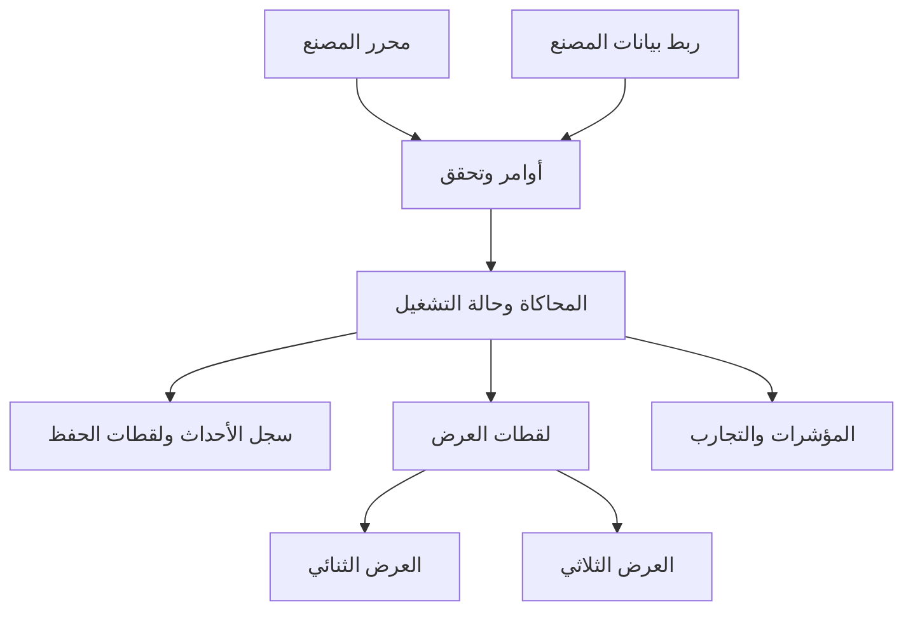

# 🧠 معمارية المحرك

## ١. حدود المسؤوليات



الأمر يطلب تغييرًا، والتحقق يقرر إمكان تطبيقه، والحدث يسجل التغيير الذي حدث فعلًا. لا يتصل محرر المجسمات مباشرة بعدادات المخزون.

## ٢. الوحدات المقترحة

| الوحدة | مسؤوليتها | ما لا تملكه |
|---|---|---|
| تعريف المصنع | قوالب وأصناف ووصفات وتخطيط وإصدارات | المخزون المتغير أثناء التشغيل |
| ساعة المحاكاة | ترتيب الأحداث وتسريع وإيقاف واستئناف | معدل إطارات الشاشة |
| العمليات | استهلاك وإنتاج وموارد وجودة | رسم المجسمات |
| المخزون والعهدة | أماكن وحجوزات وانتقالات وتتبع | اختراع نتائج إنتاج |
| توزيع المهام | اختيار مورد وتوقيت وأولوية | تجاوز قدرة المورد أو الوجهة |
| المرور والحركة | المسارات والتقاطعات والحجز والوصول | اعتماد سلامة مصنع حقيقي |
| العمال | مهارات وورديات وتكليف وتوفر | إنهاء عملية بمجرد انتهاء حركة مرئية |
| أوامر المحرر | نسخ ونقل وربط وتراجع والتحقق | تغيير التاريخ التشغيلي السابق |
| موائم العرض | تحويل الحالة إلى لقطات رسومية | منطق أصناف أو وصفات مخفي |
| موائم البيانات | استيراد وتطبيع وربط وجودة مصدر | دمج واقع وتجربة دون تمييز |
| التجارب والمؤشرات | مقارنة نتائج وسيناريوهات | تغيير إعدادات التجربة بعد حساب نتائجها |

## ٣. الزمن

- زمن العمليات المتقطعة يتحرك بين أحداث: وصول، بدء، انتهاء، عطل، إصلاح، انتهاء وردية.
- الحركة المستمرة وتفادي العوائق تستخدم تحديثًا ثابتًا أو متكيفًا مستقلًا وفق مستوى الدقة المختار.
- الرسم يستخدم لقطات حالة مؤرخة، ويحسب وضعية مرئية بين لقطتين عند الحاجة.
- يجب ألا تؤخر شاشة مغلقة الإنتاج أو تغير عدد الأجهزة المنتجة.
- إيقاف المحاكاة يوقف زمنها؛ يمكن تدوير الكاميرا والتفتيش دون تغيير الحالة.
- إعادة التشغيل تستعيد نسخة التعريف والبذرة العشوائية وتسلسل المدخلات والساعة والمهام والأحداث المعلقة.

ترتيب الأحداث المتساوية الزمن يُحدد بقواعد ثابتة معلنة، مثل أولوية الحدث ثم رقمه المتسلسل. لا تعتمد النتيجة على سرعة الرسم أو ترتيب وصول رسائل غير موثق.

## ٤. الاتساق ومنع السباق

ابدأ بكاتب منطقي واحد لحالة التشغيل. خدمات الرسم والقراءة لا تغيرها. النقل والبدء في إنتاج دفعة يُنفذان ضمن انتقال متسق: تحقق ثم حجز ثم تسجيل الحدث.

يمكن حساب الطرق أو إعداد المجسمات في عمال خلفيين، لكن النتيجة تحمل إصدار التخطيط والحالة التي بُنيت عليها. إذا تغير الإصدار، تُرفض النتيجة القديمة أو يعاد حسابها. لا نضيف تعدد كتابة موزعًا قبل ظهور حاجة مقاسة.

## ٥. الأوامر والأحداث

```text
Command: command_id, expected_revision, scenario_id, type, payload
Event: event_id, sequence, simulation_time, type, causation_id, payload
Snapshot: scenario_id, blueprint_revision, sequence, simulation_time, state
```

الأمر المكرر لا ينفذ مرتين. الحدث غير الصالح لا يكتب حالة جزئية. الأوامر الفاشلة تعيد سببًا قابلًا للفهم، مثل عدم كفاية المساحة أو فقدان المورد.

الأوامر المرئية مثل نقل خط أو تدويره تحفظ قيمًا سابقة ولا تعيد كتابة تاريخ الإنتاج. التراجع عن تصميم يختلف عن الرجوع في الزمن، الذي يحتاج لقطة وإعادة أحداث.

## ٦. العرضان

هوية العنصر واحدة في العرضين. تحديده في أحدهما يحدده في الآخر. العرض الثنائي يسقط الإحداثيات العالمية بعد تركيب تحويلات الآباء، وليس الإحداثيات المحلية وحدها. العرض الثلاثي يضيف الشكل والارتفاع والتفاصيل.

معرفات الاختيار لا تضيع عند دمج رسم العناصر أو عند تغيير مستوى التفاصيل. الإخفاء البصري لا يحذف العنصر من المحاكاة. لا تشترط المعمارية وجود محركَي رسم منفصلين؛ يمكن لمحرك واحد بكاميرتين أداء المهمة إذا أثبت الاختبار جودته.

## ٧. حفظ وتعافٍ

الحفظ يتضمن تعريفًا بإصدار، ولقطة تشغيل، وإزاحة سجل الأحداث، والبذور، والمهام والحجوزات والأحداث المعلقة. لقطات العرض مخبأ قابل لإعادة البناء وليست مصدر الحقيقة.

عند فتح ملف قديم: تحقق من الإصدار، ثم ترحيل موثق على نسخة، ثم فحص المراجع والتوافق. الملف التالف لا يفتح كأنه صالح. احتفظ بالنسخة السابقة عند ترحيل التخطيط.

## ٨. التقنية

القرار الحالي هو البناء فوق محرك رسم موجود مع إبقاء المحاكاة مستقلة. لا توجد مكتبة معتمدة بعد. تُقارن خيارات المتصفح وسطح المكتب على نفس مصنع الاختبار، مع قياس الجودة والأداء والعمل دون اتصال وحجم التوزيع وسهولة الصيانة.

لا نربط ملفات المصنع بصيغ داخلية يصعب إخراجها. الأصول الرسومية قابلة للاستبدال بعقد واضح، وتعريف المصنع قابل للتصدير والاستيراد والتحقق.
