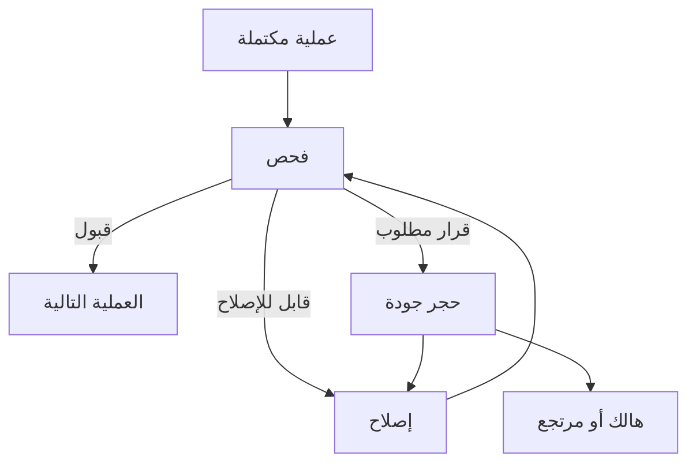

# ⚙️ الإنتاج والجودة والعمال

## ١. فصل وصفة المنتج عن طريقه

وصفة المنتج تحدد ما يدخل في المنتج وبأي كمية وإصدار. طريق التشغيل يحدد أين وبأي ترتيب وبأي موارد يحدث العمل. نتيجة الجودة تحدد التقدم أو الإصلاح أو الحجز أو الهالك.

قد يُصنع نفس الصنف على أكثر من خط، وقد يتغير الطريق حسب المقاس والموديل والسوق. لا تربط الصنف باسم محطة واحدة داخل الكود.

## ٢. عقد العملية

| الجزء | المطلوب |
|---|---|
| المدخلات | أصناف وكميات ووحدات وحالات جودة مسموحة |
| المخرجات | منتج، نواتج جانبية، هالك، وأدلة فحص |
| الموارد | آلة وعامل ومهارة وأداة ومكان خروج |
| الزمن | تجهيز، تشغيل، تحميل، تفريغ، وفحص |
| نمط التشغيل | فردي، دفعات، متوازٍ، أو تدفق مستمر مبسط |
| الشروط | إصدار وصفة، توافق موديل، خدمات، صلاحية أداة |
| الانقطاع | حفظ تقدم أو إعادة بدء أو هالك وفق العملية |
| القياس | زمن انتظار وتشغيل وتوقف ومخرجات مقبولة |

بدء العملية يحتاج سياسة حجز واضحة للمدخلات والموارد، وتحديد هل يشترط حجز مساحة خروج مسبقًا. انتهاء التشغيل مع امتلاء المخرج ينتج حالة تعذر تفريغ، ولا يحذف المنتج.

## ٣. خصوصية القطاعات

- البلاستيك: توافق الماكينة والقالب، عدد التجاويف الفعالة، تغير اللون أو المادة، بدء إنتاج، تبريد، وفحص. زمن الدورة ليس زمن خروج قطعة واحدة دائمًا.
- المعادن: تتابع الكبس والقوالب والمناولة بين العمليات، مع عدم افتراض قالب واحد يصلح لكل المقاسات.
- البوردات: خامة وبنود إلكترونية ومعجون وغيرها حسب الوصفة، ثم عمليات تركيب وفحص. موقع الفحص البصري والبرمجة والاختبار يتحدد من الواقع.
- البرمجة: المدخل بوردة مجمعة مؤهلة. توثق نسخة البرنامج والتوافق ونتيجة التحقق ومعرف مرجع عملية التهيئة؛ لا تُخزن مفاتيح سرية في تعريف المصنع.
- الشاشة: تجميع الموديول يستهلك مدخلاته المحددة. لا يُحسب الفريم مرتين داخل الموديول ثم مرة ثانية في الجهاز إلا إذا كانت الوصفة الفعلية تتطلب قطعتين مختلفتين.
- الفوم: حجم دفعة وأزمنة تعتيق وتجفيف وقوالب وتوافق المقاس؛ يمكن تمثيل المواد ككتل كمية.
- النهائي: موديل ومقاس وتسلسل تجميع واختبارات وتعبئة تشمل الكرتون والملحقات والملصقات، ولا تقتصر على الأجزاء الكبيرة.

## ٤. التوازي والموارد المشتركة

منصة برمجة بأربع فتحات تحتاج تعريفًا: هل تبدأ الأربع معًا كدفعة، أم لكل فتحة عملية مستقلة؟ هل عامل واحد يستطيع تحميل فتحات أثناء عمل غيرها؟ ما أثر فشل فتحة؟

لا نستنتج الإنتاجية من قسمة زمن العملية على عدد الفتحات فقط؛ يجب احتساب التحميل والتفريغ والانتظار والإتاحة.

الموارد المشتركة تشمل فني صيانة وأداة فحص وقالبًا وعاملًا وكلاركًا. الحجز يمنع أن يعمل المورد نفسه في مهمتين متعارضتين.

## ٥. العمال

العامل لديه مهارة وصلاحية تكليف ووردية وتوفر، وليس مجرد مجسم يمشي. مهمة عامل المناولة تشمل الوصول للتروللي، والتقاطه، والتحرك، والتفريغ، وفك الارتباط أو العودة وفق السياسة.

مسافة الانتقال والوقت تؤثران في توافر العامل. الاستراحات والتبديل بين المحطات تسجل. التغييرات في سرعة أو قدرة فرد تستخدم افتراضات معلنة أو بيانات مجمعة؛ لا نستنتج سلوك شخص من الرسوم.

الحركة المرئية تتبع حالة العمل: انتظار، مشي، دفع، التقاط، تحميل، فحص. انتهاء الحركة الرسومية لا يقرر نجاح الفحص أو انتهاء عملية الإنتاج.

## ٦. الجودة والإصلاح

تحدد كل وصفة حدًا أو سياسة لتكرار الإصلاح، وموارد الإصلاح ووقته ومصير المواد المفكوكة. سلسلة تتبع الجهاز تربطه بالبوردات والموديول والدفعات عند مستوى التتبع المطلوب.

## ٧. الأعطال وتغيير الموديل

العطل يحدد المورد المتوقف، وسببًا، وحالة المنتج داخله، وطلب الصيانة. زمن الفشل والإصلاح يستند إلى بيانات أو توزيع افتراضي معلن. الخدمة المستعادة لا تعني إعادة المنتج إلى حالة سليمة دون فحص إذا كانت السياسة تتطلب ذلك.

تغيير الموديل يتضمن إنهاء أو إخلاء العمل الجاري، وتغيير الأدوات، والتحقق من البرنامج والوصفة، ووقت التجهيز، واعتماد أول قطعة عند الحاجة. لا يتم بتغيير اسم المنتج فقط.

## ٨. المؤشرات وتعريفها

| المؤشر | التعريف |
|---|---|
| الإنتاج المقبول | عدد المخرجات المقبولة عند حد قياس معلن |
| المخزون تحت التشغيل | المواد التي دخلت نطاق الإنتاج ولم تغادره |
| زمن المرور | الزمن بين نقطتي دخول وخروج محددتين |
| زمن الدورة | زمن تنفيذ عملية أو الفاصل بين مخرجات؛ يسمى بوضوح |
| زمن التاكت | وقت الإنتاج المتاح ÷ الطلب المطلوب في نفس الفترة |
| استغلال المورد | زمن انشغاله ÷ الزمن المرجعي المعلن |
| العائد من أول مرور | المقبول دون إصلاح ÷ الداخل للفحص المحدد |
| فعالية المعدة | الإتاحة × الأداء × الجودة وفق تعريف أزمنة معلوم |
| تكلفة المناولة | وقت وموارد ومسافات بأسعار مدخلة ومعلنة |

تقارير الاختناق تفرق بين انشغال فعلي، ونقص خامة، وامتلاء مخرج، وغياب عامل، وعطل. المتوسط وحده لا يثبت سبب الاختناق.
