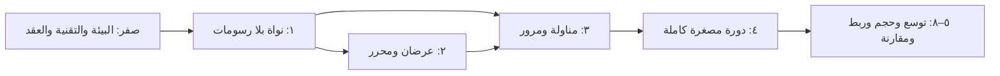

# 🧰 خطة التنفيذ التفصيلية

هذا الملف يفصّل [مراحل التنفيذ](09_ROADMAP.md) إلى حزم عمل صغيرة مرتبة، لكل حزمة مخرجات واختبار قبول ودليل. لا يستبدل المراحل ولا شروط خروجها، ولا يعني أن التنفيذ البرمجي بدأ.

**الحالة: خطة فقط. لم تُنفذ أي حزمة، ولم تُعتمد أي تقنية.**

معرفات `V` تشير إلى [خطة التحقق](10_VALIDATION_AND_PERFORMANCE.md)، ومعرفات `D` إلى [سجل القرارات](11_DECISIONS_AND_OPEN_QUESTIONS.md).

## ١. منطق الترتيب

نبني من الداخل للخارج: الحساب الصحيح أولًا، ثم العرض، ثم الحركة، ثم دورة المصنع الكاملة.

سبب هذا الترتيب: خطأ في المخزون أو الزمن يختفي خلف مشهد جميل، لكنه يظهر فورًا في سجل أحداث بلا شاشة. لذلك لا تُرسم حركة قبل وجود حالة صحيحة تُقرأ منها.

## ٢. قواعد هندسية ثابتة مهما كانت التقنية

هذه مقترحات تنفيذ مسجلة في D17، وتُثبت أو تُعدل بعد حزمة العمل الأولى التي تستخدمها.

| القاعدة | التفصيل | الخطأ الذي تمنعه |
|---|---|---|
| زمن صحيح | ساعة المحاكاة عدد صحيح من الملّي ثانية؛ أزمنة التعريف بالثواني تتحول مرة واحدة عند التحميل | انجراف الكسور واختلاف النتائج بين جهازين |
| كميات صحيحة | الرصيد عدد صحيح بأصغر وحدة للصنف: قطعة للعدد، جرام للكتلة | رصيد مثل `0.30000000004` وفشل مطابقة التوازن |
| ترتيب أحداث معلن | المفتاح: `(time, priority, sequence)` | نتيجة تعتمد على ترتيب إدراج غير موثق |
| عشوائية مسماة | مولد ببذرة، وتيار مستقل لكل نظام فرعي | تغير نتائج الأعطال عند إضافة سحب عشوائي في المناولة |
| بصمة حالة | تسلسل قانوني للحالة ثم تجزئة، عند نقاط فحص | مقارنة تشغيلين بالعين بدل دليل |
| نواة بلا رسم | وحدات المجال والمحاكاة لا تستورد مكتبة عرض؛ يفحصها اختبار اعتماديات | تسرب منطق الإنتاج إلى المشهد |
| قراءة فقط للعرض | العرض يستقبل لقطات مؤرخة ويرسل أوامر؛ لا يملك مرجعًا قابلًا للكتابة للحالة | مجسم يغير مخزونًا |
| فاحص ثوابت | ثوابت [خطة التحقق §٣](10_VALIDATION_AND_PERFORMANCE.md) تُفحص بعد كل انتقال ملتزم في وضع الاختبار | اكتشاف الرصيد السالب بعد ألف حدث من سببه |

## ٣. المرحلة صفر: البيئة والتقنية والعقد

| الحزمة | العمل | المخرج | القبول |
|---|---|---|---|
| WP0.1 | جرد الجهاز المستهدف: النظام، المعالج، الذاكرة، كارت الرسوم، المتصفح، الشاشة، قيود التثبيت والشبكة | تقرير بيئة موقّع بتاريخ ومصدر | أسئلة المرحلة صفر في [القرارات §٣](11_DECISIONS_AND_OPEN_QUESTIONS.md) مجابة أو مفترضة صراحة |
| WP0.2 | تجربة مقارنة على مشهد واحد صغير، انظر §٣.١ | جدول قياس وقرار تقنية مسبب يحدّث D14 | القياس مأخوذ على الجهاز المستهدف، لا بيئة الوكيل |
| WP0.3 | تثبيت عقد البيانات الأول: فصل تعريف المصنع عن شروط بداية السيناريو، وفاحص دلالي للعينة | فاحص يعمل من سطر الأوامر، وعينة تجتازه | V01، V21 على ملفات معطوبة عمدًا |

WP0.3 لا تعتمد على اختيار محرك الرسم، ويمكن بدؤها قبل اكتمال WP0.1.

### ٣.١ تجربة مقارنة التقنية

المشهد نفسه لكل مرشح: أرضية بمقياس، وعدد متزايد من صناديق بأبعاد حقيقية تتحرك على مسارات، وكاميرتان علوية ومنظورية، وتحديد عنصر بالنقر داخل رسم مجمع.

| المرشح | سبب التجربة | ما يجب أن يثبته |
|---|---|---|
| نواة TypeScript + مكتبة رسم ويب قائمة | لغة واحدة للنواة والمحرر والعرض؛ النواة تعمل بلا شاشة للاختبار؛ توزيع بلا تثبيت | زمن إطار مقبول عند الحجم المطلوب، وعمل دون اتصال، وثبات تحديد العناصر المجمعة |
| نفس النواة داخل غلاف سطح مكتب | وصول لملفات محلية وتوزيع مغلق | حجم توزيع وقيود تثبيت مقبولة في المصنع |
| محرك ألعاب جاهز مع نواة مستقلة | أدوات مشهد وإضاءة وحركة جاهزة | بقاء النواة قابلة للاختبار بلا المحرر، وترخيص مناسب |

المرشح الأول هو الترشيح المبدئي (D18) لأنه يحقق فصل النواة بأقل تكلفة صيانة. يبقى ترشيحًا حتى يُقاس؛ إذا فشل شرط الجهاز أو التوزيع ينتقل القرار للمرشح التالي دون تغيير عقود النواة.

معايير القرار: العمل على الجهاز الفعلي، العمل دون اتصال، زمن الإطار ودرجاته المئينية عند ثلاثة أحجام، الذاكرة، حجم التوزيع، وسهولة تشغيل النواة بلا شاشة.

## ٤. المرحلة الأولى: نواة بلا رسومات

| الحزمة | العمل | القبول |
|---|---|---|
| WP1.1 | أنواع الهوية والوحدة والكمية؛ رفض الجمع بين وحدتين مختلفتين | V21 |
| WP1.2 | تحميل التعريف وفحص الإصدار والمراجع ودورات الأب المكاني | V01، V23 |
| WP1.3 | ساعة الأحداث: طابور، ترتيب معلن، إيقاف واستئناف وتسريع، عشوائية مسماة | V24؛ نفس البذرة تعطي نفس البصمة |
| WP1.4 | دفتر المخزون: مواقع، وحدات مناولة، تحويل، حجز، حالات المادة | V04، V08، V14 مع فاحص الثوابت |
| WP1.5 | بوابة الأوامر: `command_id` لمنع التكرار، `expected_revision`، سبب رفض مقروء | V05 |
| WP1.6 | عملية واحدة: حجز مدخلات، تشغيل، مخرجات، حالات نقص خامة وتعذر تفريغ وعطل | V08، V10 |
| WP1.7 | لقطة حفظ واستئناف وإعادة تشغيل من السجل | V16: بصمة التشغيل المستأنف تساوي غير المنقطع |
| WP1.8 | مشغل سطر أوامر وتقرير تجربة: أحداث، أرصدة، مؤشرات، بصمة | تشغيل قابل للإعادة بأمر واحد موثق |

شريحة الاختبار: خامة بوردة ← تجميع ← برمجة، بأرصدة ابتدائية من العينة. المناولة في هذه المرحلة انتقال فوري معلن كقيد، وتُستبدل في المرحلة الثالثة.

## ٥. المرحلة الثانية: عرضان ومحرر

| الحزمة | العمل | القبول |
|---|---|---|
| WP2.1 | تركيب التحويلات وإعادة الإلحاق، باختبارات خصائص على قيم عشوائية | V02، V03 |
| WP2.2 | عقد لقطة العرض: إصدار، زمن محاكاة، هويات، مواضع عالمية، حالة مرئية | النواة تنتج اللقطة بلا مكتبة رسم |
| WP2.3 | عرض ثنائي من الإحداثيات العالمية | موضع منفذ مرسوم يساوي المحسوب بعد تدوير الأب |
| WP2.4 | عرض ثلاثي ببدائل صندوقية بأبعاد القالب، ومشهد معايرة | مسطرة المشهد تطابق أبعاد التعريف |
| WP2.5 | تحديد موحد بهوية العنصر في العرضين، يشمل الرسم المجمع | V18 |
| WP2.6 | أوامر المحرر: إضافة، نقل، تدوير، نسخ، حذف، تراجع، حفظ وتحميل، وفحص تداخل وحدود | V22؛ حفظ ثم تحميل يعيد نفس بصمة التخطيط |
| WP2.7 | اختبار استقلال العرض | V15: نفس بصمة الأحداث بشاشة وبدونها |

المجسمات التفصيلية مؤجلة عمدًا. صندوق بأبعاد صحيحة يثبت العقد؛ مجسم جميل بأبعاد خاطئة يخفي الخطأ.

## ٦. المرحلة الثالثة: مناولة ومرور وعامل

| الحزمة | العمل | القبول |
|---|---|---|
| WP3.1 | شبكة ملاحة وإيجاد طريق حسب نمط الوسيلة وعرض الممر؛ مخبأ مرتبط بإصدار التخطيط | غياب الطريق يعيد سببًا، لا طريقًا وهميًا |
| WP3.2 | قواعد مرور: حجز حواف وتقاطعات، انتظار، كشف تعطل متبادل | V12 |
| WP3.3 | آلة حالات مهمة النقل: طلب، حجز خامة ووسيلة وعامل ووجهة، تحميل، نقل، تفريغ، إلغاء، تعثر | V07، V09 |
| WP3.4 | سياسة إعادة التغذية مع احتساب الوارد المؤكد | V06 |
| WP3.5 | ارتباط العامل بالتروللي وفكه كانتقال متسق | لا عامل مرتبط بوسيلتين؛ فك الارتباط لا يحرك الحمولة |
| WP3.6 | حركة مرئية محسوبة بين لقطتين، موسومة «تقديرية» | إيقاف العرض لا يغير زمن الوصول |

## ٧. المرحلة الرابعة: دورة مصغرة كاملة

| الحزمة | العمل | القبول |
|---|---|---|
| WP4.1 | مسار البوردة بفحص وإصلاح وإعادة فحص | V11 |
| WP4.2 | تجميع نهائي وفحص وتعبئة بوصفة كاملة وسيريال لكل جهاز | لا سيريال مكرر؛ سلسلة مكونات الجهاز قابلة للاستعلام |
| WP4.3 | مخزن منتج تام وشحن بوحدات مناولة وخطة رص بقيود وزن وأبعاد | V20 |
| WP4.4 | نقل خط في نسخة تصميم مع مهمة جارية | V13 |
| WP4.5 | سيناريوهات التعثر الأربعة من [تسليم التنفيذ §٤](13_IMPLEMENTATION_HANDOFF.md): عطل، امتلاء مخرج، طريق مغلق، تكرار طلب | توازن المادة محفوظ في كل سيناريو |
| WP4.6 | مستند نتائج التجربة مع القيود وما لم يُختبر | يعاد إنتاجه من المستودع بأمر موثق |

باقي الأجزاء، مثل البلاستيك والمعادن والفوم وموديول الشاشة، تدخل هذه الشريحة كأرصدة ابتدائية معلنة، ثم تُبنى خطوطها في المرحلة الخامسة.

## ٨. المراحل من الخامسة إلى الثامنة

لا تُفصّل الآن إلى حزم؛ تفصيلها يعتمد على قياسات وعقود تثبتها المراحل الأربع الأولى. عند الوصول لكل مرحلة يُضاف جدول حزمها هنا قبل بدء العمل، مع بقاء شروط خروجها في [مراحل التنفيذ](09_ROADMAP.md).

سؤال فحص ثابت قبل دخول المرحلة الخامسة: هل أُضيف قطاع جديد بتعريف وبيانات فقط؟ إذا احتاج تعديل منطق مركزي، يُصلح العقد أولًا.

## ٩. أنواع الاختبار

| النوع | ما يثبته | مثال |
|---|---|---|
| وحدة | قاعدة واحدة | رفض تحويل بوحدة خاطئة |
| خصائص | ثابت على مدخلات عشوائية كثيرة | تدوير ونقل ثم عكسهما يعيد الموضع |
| سيناريو | سلوك شريحة بسجل أحداث مرجعي | نقص خامة ثم تغذية واحدة فقط |
| حتمية | تشغيلان بنفس البذرة | تساوي البصمتين |
| استئناف | حفظ في المنتصف | تساوي البصمة النهائية |
| استقلال العرض | بشاشة وبدونها | تساوي بصمة الأحداث |
| قياس أداء | زمن وذاكرة على جهاز مسمى | تقرير بالمواصفات والسيناريو |

لا يُكتب اختبار يعيد صياغة التنفيذ نفسه. كل اختبار يذكر الحالة `V` التي يغطيها أو الثابت الذي يحميه.

## ١٠. شكل كل تسليم

حزمة عمل واحدة لكل تغيير مراجعة. يحتوي التغيير على: السلوك، واختباره، وأمر تشغيل قابل للإعادة، وتحديث الملف المختص و[تغطية المتطلبات](14_REQUIREMENTS_TRACEABILITY.md) و[سجل التغييرات](../CHANGELOG.md)، وبيان ما لم يُختبر.

حزمة لم تحقق قبولها تُسلّم كتقرير بما فشل وسببه، ولا تُعلّم مكتملة.

## ١١. ما يلزم من صاحب المشروع قبل WP0.2

| السؤال | الافتراض إذا لم تتوفر إجابة |
|---|---|
| مواصفات جهاز التشغيل والشاشة | لا افتراض؛ القياس يُعلن على جهاز مسمى فقط |
| متصفح أم تطبيق سطح مكتب | متصفح يعمل دون اتصال، مع إبقاء خيار الغلاف مفتوحًا |
| مستخدم واحد أم عدة مستخدمين | مستخدم واحد وكاتب منطقي واحد (D12) |
| بيانات مصنع حقيقي أم افتراضية | بيانات العينة الافتراضية الموسومة |

هذه الإجابات لا تمنع بدء WP0.3 والمرحلة الأولى؛ كلتاهما مستقلتان عن محرك الرسم.
